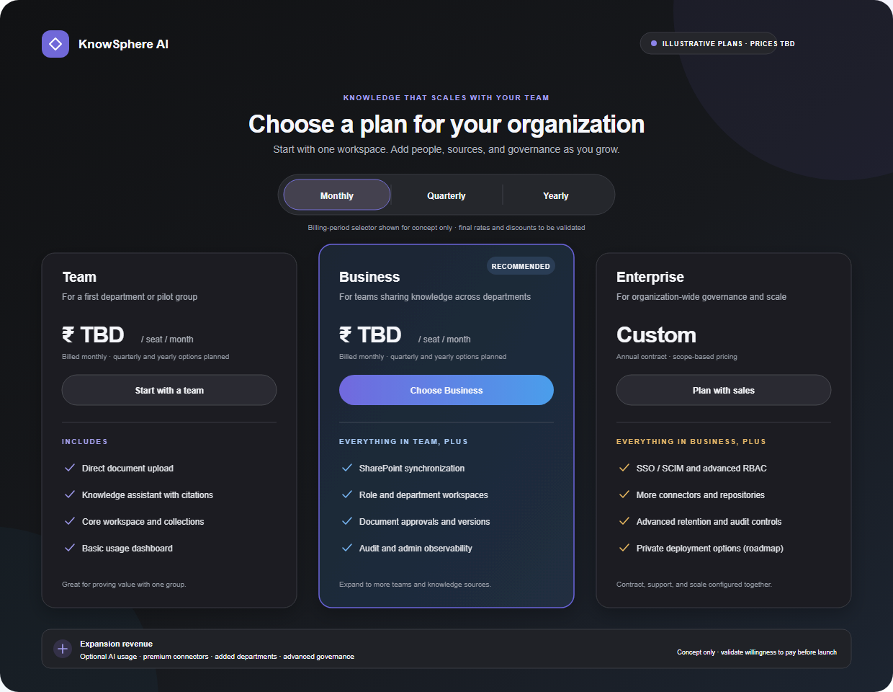

# KnowSphere AI

A runnable, local-first starter for the KnowSphere AI product: a role-specific React portal backed by a FastAPI API with server-side authorization, permission-filtered document retrieval, session cookies and audit events.

## What works in this starter

- Separate admin and employee portal experiences with role-specific navigation.
- Local email/password sign-in and server-side, HttpOnly sessions.
- SQLite organization, user, document and audit-event storage.
- Server-side document visibility rules for organization admins, knowledge managers, HR, managers, employees and compliance auditors.
- Permission filtering before knowledge search results and citations are returned.
- Gemini semantic retrieval and answer generation, with citations restricted to retrieved passages and page numbers.
- Multi-turn assistant conversations with follow-up context for search and answer framing; previous answers are context only, never evidence.
- Startup indexing of the selectable text in the seven sample PDFs under `policyinfo/`, with content-change detection and page-aware chunks.
- Admin overview, role-aware audit log and a document-backed retrieval demo.
- Organization admins can inspect every organization document scope and all organization members.
- Organization admins can change another member’s role and department; changes are audit logged.
- Organization admins and knowledge managers can upload TXT/Markdown documents for review and publish reviewed documents.
- Audit events can be exported to CSV.
- Responsive dashboard, knowledge library, integrations and AI observability screens.

## Product demo and pricing

[Watch the 7½-minute narrated KnowSphere AI product tour](docs/demo/knowsphere-product-tour.mp4) · [Read the voiceover script](docs/demo/voiceover-script.md)

The video uses a Microsoft Prabhat English (India) voice and covers sign-in, every admin panel, and the HR and employee workspace panels, including illustrative assistant chat examples. KnowSphere currently uses Gemini for embeddings and answer generation; its product distinction is permission-filtered retrieval, source citations, and workspace governance around that model. The chat answers in the video are scripted examples with sample citations, not live Gemini responses.

The supplied pricing image is included as a visual reference. It still shows “TBD”; use the current rates in the table below. Team and Business have the same rates, and Enterprise is custom.



| Billing period | Team | Business | Enterprise |
|---|---:|---:|---|
| Monthly | ₹7,999 | ₹7,999 | Custom |
| Quarterly | ₹14,999 | ₹14,999 | Custom |
| Yearly | ₹21,999 | ₹21,999 | Custom |

The reference presents seat-based pricing. It is a concept image, and tax, discounts, and contract terms are not specified. Items pictured there such as SharePoint/Google Drive synchronization, Confluence, SSO/SCIM, document versioning, advanced observability, and private deployment are not implemented in this MVP. Direct TXT/Markdown upload, review and publish, role/department access rules, cited assistant responses, and audit CSV export are available in the current build.

## Local development

Requirements: Node.js 20+ and Python 3.11+.

1. Install frontend dependencies:

   ```powershell
   npm install
   ```

2. Create and activate a Python environment, then install backend dependencies:

   ```powershell
   py -3.12 -m venv .venv
   .\.venv\Scripts\Activate.ps1
   python -m pip install -r requirements-dev.txt
   ```

3. Start the API in one terminal:

   ```powershell
   $secure = Read-Host "Gemini API key" -AsSecureString
   $env:GEMINI_API_KEY = [System.Net.NetworkCredential]::new("", $secure).Password
   $env:GEMINI_MODEL = "gemini-3.6-flash"
   python -m uvicorn backend.main:app --reload --host 127.0.0.1 --port 8002
   ```

   Enter the key at the secure prompt in the same terminal before starting the API. Gemini is required for every document question: the API returns an explicit error if the key is missing or Gemini is unavailable; it does not fall back to keyword search or local-only answers. Basic greetings and thanks receive a brief conversational reply and do not query documents. `GEMINI_MODEL` defaults to `gemini-3.6-flash`; if it is temporarily unavailable, generation retries with `GEMINI_FALLBACK_MODEL` (defaults to `gemini-3.5-flash-lite`). `GEMINI_EMBEDDING_MODEL` defaults to `gemini-embedding-001`.

   On the first search (and whenever the embedding model changes), the backend sends the current user's permission-filtered document chunks to Gemini's embedding API to build semantic search vectors. Each search also sends the question for embedding, then sends only the top authorized passages to Gemini to draft a cited answer. Review your organization's data handling and Google's provider terms before using confidential documents. Keep the key on the backend; never put it in React code, `VITE_*` variables, commits, screenshots or chat.

   On startup, the backend indexes selectable text from the PDFs in `policyinfo/`; scanned/image-only PDFs require OCR and currently stop indexing with an explicit error. The sample PDFs are assigned access scopes in the backend. Search and citations apply those scopes before document passages reach the embedding or answer-generation calls.

4. Start the web app in another terminal:

   ```powershell
   npm run dev
   ```

   Open the Vite URL (normally `http://localhost:5173`).

The local demo database is created on first API startup. The seeded demo accounts all use `KnowSphereDemo2026!`:

| Role | Email |
|---|---|
| Organization admin | `admin@knowsphere.local` |
| Knowledge manager | `knowledge@knowsphere.local` |
| HR | `hr@knowsphere.local` |
| Manager | `manager@knowsphere.local` |
| Employee | `employee@knowsphere.local` |
| Compliance auditor | `auditor@knowsphere.local` |

Set `KNOWSPHERE_DEMO_PASSWORD` before the database is first created to use a different local demo password. Set `KNOWSPHERE_DATABASE` to change the SQLite database location.

## Tests and build

```powershell
python -m unittest discover -s tests
npm run build
```

## Important scope and deployment notes

This is an MVP foundation, not a production deployment. Direct document upload currently accepts TXT and Markdown up to 80 KB; uploads are private until an authorized organization admin or knowledge manager publishes them. The assistant uses Gemini embeddings to rank only the current user's authorized, published passages, then uses Gemini to answer with citations validated against those retrieved passages. Follow-up questions include recent chat turns to resolve references, but previous assistant answers are not treated as evidence. Citations show PDF page numbers. If Gemini is not configured or cannot be reached, the endpoint reports an error instead of returning a fallback answer. This is not a guarantee of factual correctness; review answers against their cited sources. PDF ingestion currently requires selectable text; OCR, DOCX upload, malware scanning, SharePoint/Google OAuth and source synchronization, invitation and password reset flows, SSO, billing, and Langfuse/OpenTelemetry instrumentation are not wired yet. Conversation history remains in the current page session and is not stored in the database.

Before deploying: configure HTTPS and `KNOWSPHERE_COOKIE_SECURE=true`, replace demo credentials, use a managed database and secret store, add CSRF protection appropriate to the deployment, rate limiting, email verification/password recovery, tenant provisioning, operational monitoring and security review. The local demo users and password are for development only.

If an API key was pasted into chat, screenshots, source code or another shared place, revoke it in Google AI Studio and create a replacement. Do not commit the replacement key.
